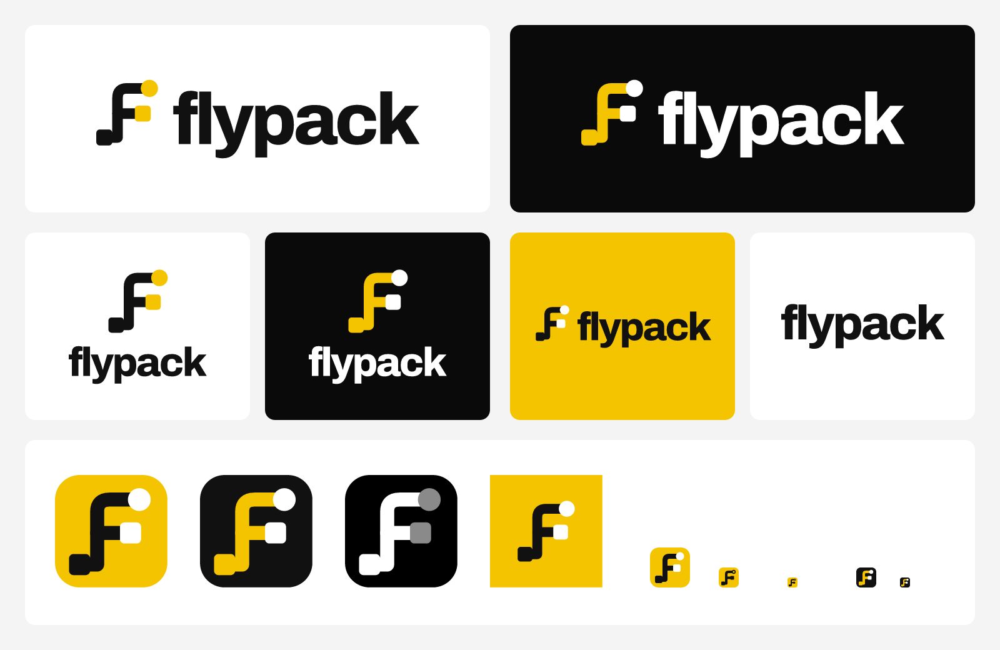

# Flypack brand kit



The mark is a cable route drawn as an F: a pad where the cable starts, a dot where it ends, and a pad where the crossbar lands. The wordmark is Archivo ExtraBold at −0.045em tracking, converted to outlines, so no file here needs the font installed.

Tagline: **Show up knowing.** How it was chosen, and the lines that were turned down, are in [TAGLINE.md](TAGLINE.md).

Design source: the "Brand kit v1" page of the Paper file [Flypack — Logo exploration](https://app.paper.design/file/01M65S3PQBM4ZSMGEAZ3F78QB6).

## What's here

| Folder | Contents |
| --- | --- |
| `logo/` | Horizontal and stacked lockups, wordmark, and mark, as SVG and PNG |
| `app-icon/` | App icons: light, dark and tinted (full-bleed squares for app stores) plus rounded versions for web and decks, as SVG and 1024px PNG |
| `favicon/` | `favicon.svg`, `favicon.ico`, PNG favicons, Apple touch icon, PWA icons and `site.webmanifest` |
| `social/` | Open Graph cards, 1200×630, dark and light |
| `tokens/` | `flypack.css`: every shadcn/ui and Tailwind v4 color, font and type token. See [tokens/README.md](tokens/README.md) |
| `scripts/` | `build.mjs`, which generates everything above |
| `explorations/` | Earlier logo rounds, kept for reference |

In file names, `light` and `dark` describe the background the asset goes on. `black` and `white` are single-color versions for print, embroidery and engraving.

## Which file to use

| Where | File |
| --- | --- |
| Site header, docs, light UI | `logo/flypack-horizontal-light.svg` |
| Dark UI, slides on black | `logo/flypack-horizontal-dark.svg` |
| Square spaces, splash screens | `logo/flypack-stacked-light.svg` or `-dark.svg` |
| Avatars, social profiles | `app-icon/app-icon-light-rounded-1024.png` |
| One-color print | `logo/flypack-horizontal-black.svg` or `-white.svg` |
| Tiny spaces (under 96px wide) | The mark alone: `logo/flypack-mark-light.svg` or `-dark.svg` |

## Favicons

Copy everything in `favicon/` to the site's public root, then add:

```html
<link rel="icon" href="/favicon.ico" sizes="48x48" />
<link rel="icon" href="/favicon.svg" type="image/svg+xml" />
<link rel="apple-touch-icon" href="/apple-touch-icon.png" />
<link rel="manifest" href="/site.webmanifest" />
<meta name="theme-color" media="(prefers-color-scheme: light)" content="#FFFFFF" />
<meta name="theme-color" media="(prefers-color-scheme: dark)" content="#0A0A0A" />
```

- `favicon.svg` switches between the yellow tile and the ink tile with the browser's color scheme.
- The 16px and 32px bitmaps use ink endpoints, because white endpoints wash out on yellow at that size.
- `icon-maskable-*.png` keeps the mark inside Android's safe zone, so circular and squircle masks don't clip it.

## App icons

- **iOS and macOS:** use `app-icon-light-1024.png`, `app-icon-dark-1024.png` and `app-icon-tinted-1024.png` as the Any, Dark and Tinted appearances in the asset catalog. They are full-bleed squares; the system applies the corner mask.
- **Android:** the adaptive icon background is Gaff Yellow `#F5C400`. The foreground is the mark as drawn in `app-icon-light.svg` (ink route, white endpoints), scaled down to sit inside the safe zone; `favicon/icon-maskable-512.png` shows the right size.

## Colors

| Name | Hex | Use |
| --- | --- | --- |
| Case Ink | `#111111` | Text, marks, dark-mode cards |
| Gaff Yellow | `#F5C400` | Brand, live, selection; never as text on light backgrounds |
| White | `#FFFFFF` | Light background |
| Stage Black | `#0A0A0A` | Dark-mode background |

The full system, with contrast checks, is in [tokens/README.md](tokens/README.md).

## Rules

- Keep clear space around the logo equal to twice the height of the yellow dot.
- Don't recolor the route, stretch the mark, drop an endpoint, or put the yellow mark on yellow.
- Below 96px wide, use the mark alone instead of the lockup.

## Rebuilding

```sh
cd brand/scripts
pnpm install
pnpm build
```

The script downloads static Archivo instances from Google Fonts into `scripts/.cache/` on first run. Archivo is licensed under the SIL Open Font License, which allows logos made from it.
